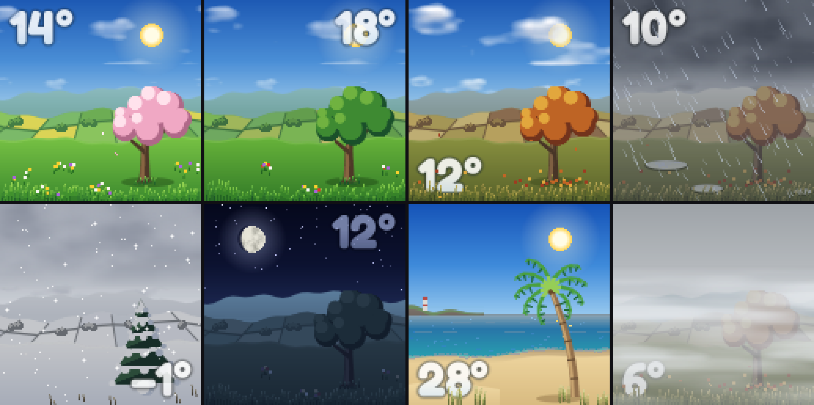
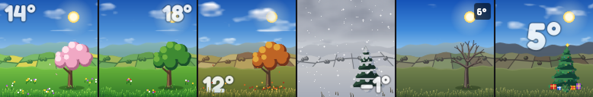
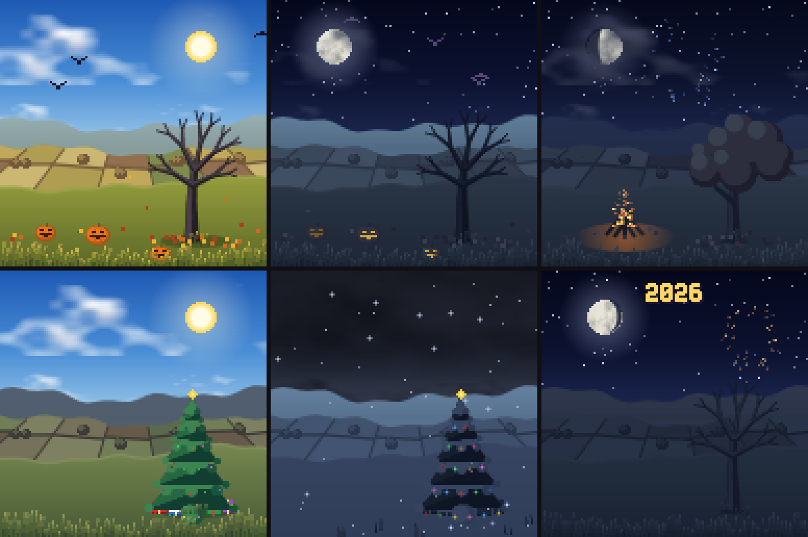

# Weather Scenes for the Art Matrix

The weather outside as a little animated landscape, for
[Pimoroni's Art Matrix](https://github.com/pimoroni/artmatrix) (128×128 RGB LEDs).



A warm clear day is a beach. A cooler one is the countryside as the season has it: blossom
in spring, full leaf in summer, falling leaves in autumn and a bare tree in winter. Rain
falls from grey cloud, snow settles, fog rolls over the land, and the tree sways harder
the stronger the wind blows. Night, sunrise and sunset light the whole scene, with the
moon in its real phase.

The frames here were captured from the plugin running on an Art Matrix.

## The temperature

It goes in any corner or the middle, or nowhere, and is either blended into the scene or
on a plain card.



Blended, the digits take the scene's light and the weather passes over them: cloud and
fog drift in front, the nearer rain and snow fall in front and the further behind, and in
a bottom corner the grass grows up over their feet.

## Festive days



| Theme | When | What changes |
|---|---|---|
| Christmas | 1 December to 5 January | A fir with twinkling lights, a star on top and presents at its foot. On the beach the lights wind up the palm |
| New Year | 31 December and 1 January | Fireworks after dark and the year across the sky |
| Halloween | 25 to 31 October | A bare dark tree, pumpkins with candles in, and bats |
| Bonfire Night | 5 November | A bonfire in the meadow, and fireworks after dark |

The weather itself is left alone: it only snows at Christmas when it's snowing.

## Settings

On the plugin's config page:

- **Location:** latitude and longitude. Blank uses the firmware's Weather plugin's.
- **Units:** Celsius or Fahrenheit.
- **Temperature:** top left, top right, bottom left, bottom right, centre or none.
- **Blend the temperature in:** on or off.
- **Beach from:** how warm a clear day has to be for the beach.
- **Season:** by the calendar (and the hemisphere), or one fixed.
- **Festive days:** by the calendar, off, or one fixed.
- **Show:** the live weather, or a demo that steps through all 24 scenes.

## How it works

- **Weather:** fetched from [Open-Meteo](https://open-meteo.com/), which needs no key:
  the temperature, weather code, cloud cover, wind and gusts, and the day's sunrise and
  sunset. `__init__.py` turns a reading into one state dict and the layers draw from it.
- **Layers:** `sky.py` draws the sky, sun, moon, stars, clouds, fog, rain, snow, hail and
  lightning. `scenery.py` draws the land, the tree and the grass. `temperature.py` blends
  the temperature in, and `festive.py` dresses the scene up on its days.
- **Speed:** the parts that touch every pixel are `@micropython.viper` kernels, and
  anything that only changes with the weather or the light is drawn once and kept. A frame
  takes 10 to 20 ms on the board, depending on the scene.

## Install

### Over USB

```bash
tools/deploy.sh /dev/ttyACM0     # needs mpremote; MPREMOTE=/path/to/mpremote to pick one
```

This copies `weather_scenes/` to `/lib/plugins/weather_scenes` and resets the board. The
firmware adds a new plugin folder switched off, so switch **Weather Scenes** on at
`http://<name>.local`.

Connecting with mpremote stops the running firmware, so reset the board afterwards
(`mpremote reset`, or the RESET button).

The sources are large, and the board compiles them each time it
starts. To skip that, compile each `.py` with
`mpy-cross -march=armv7emsp` (mpy-cross 1.29) and copy the `.mpy` files in place of the
`.py` ones. MicroPython loads a `.py` ahead of an `.mpy` of the same name, so remove the
`.py`.

### From the catalogue

The install page only lists plugins in
[pimoroni/artmatrix-plugins](https://github.com/pimoroni/artmatrix-plugins). To offer it
there, put `weather_scenes/` in that repository and run its `ci/generate_packages.py`.

## Licences

The code is under the MIT License (`LICENSE`). The temperature's digits are Fredoka Bold,
under the SIL Open Font License 1.1 (`weather_scenes/OFL-Fredoka.txt`). Weather data is
from Open-Meteo.
